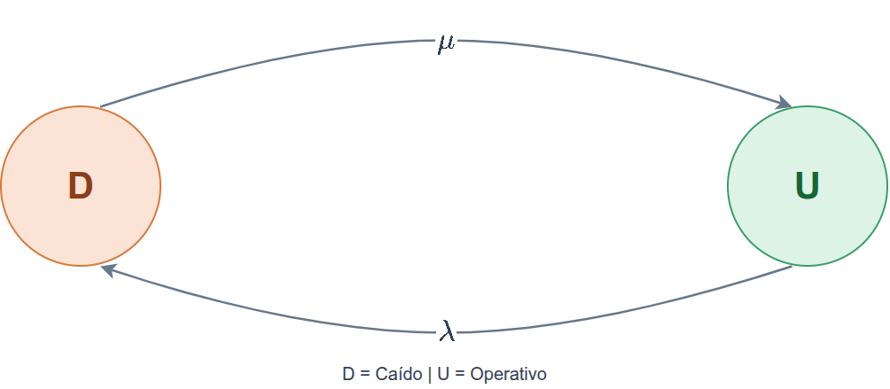
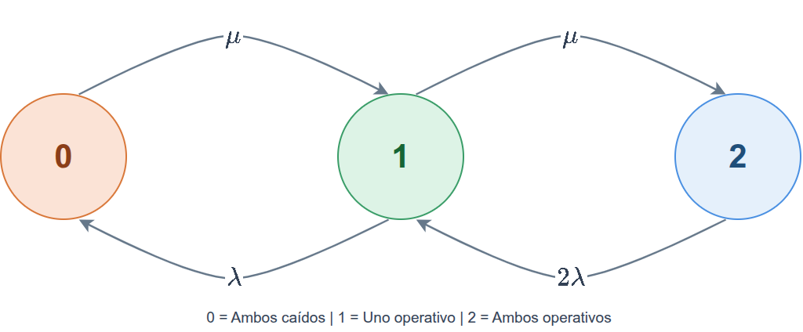
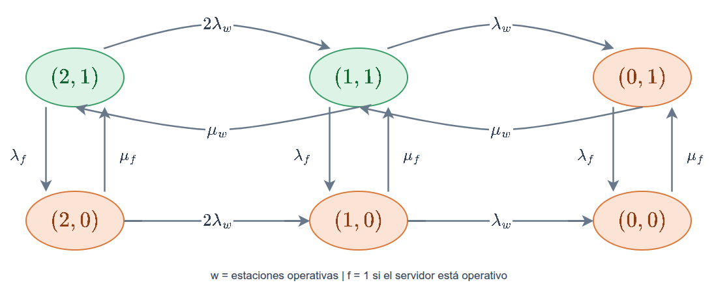

<!-- _class: lead -->

# TEL211
## Disponibilidad y Rendimiento de Sistemas TIC
### Cadenas de Markov en tiempo continuo y disponibilidad

Patricio Olivares R.  
Universidad Técnica Federico Santa María

---

## Continuidad

En la clase 04 observamos un sistema reparable en pasos de duración fija. Calculamos su distribución futura y sumamos los estados que prestan servicio.

Ahora queremos seguirlo mientras los eventos ocurren en cualquier instante:

$$
\text{operativo}\rightarrow\text{caído}\rightarrow\text{operativo}.
$$

Conservamos los estados y el criterio de servicio. Cambiamos la forma de describir el tiempo y las transiciones.

---

## Ruta de esta unidad

- ¿Cómo construir un modelo con tasas y permanencias? 
- ¿Cómo evoluciona la disponibilidad de un sistema reparable? 
- ¿Cómo incorporar varios componentes y una política de reparación?

Primero construiremos la matriz $Q$. Después obtendremos probabilidades y métricas a partir del mismo modelo.

---

## ¿Qué es una CTMC?

Una **cadena de Markov en tiempo continuo**, abreviada CTMC, tiene estados discretos y un índice temporal continuo:

$$
\{X(t):t\geq0\},\qquad X(t)\in\mathcal S.
$$

Siendo $\mathcal S$ el conjunto de estados.

Conocido el estado presente, el pasado no agrega información para describir la evolución futura.

Por ejemplo, $X(t)$ puede indicar si un enlace está operativo o caído, o cuántos servidores funcionan en el instante $t$.

---

## Tiempo continuo y homogeneidad

Una falla puede ocurrir a los $2.4$ minutos y una reparación terminar a los $5.7$ minutos. No necesitamos redondear esos eventos a pasos enteros.

En esta unidad usaremos **CTMC homogéneas**: sus tasas no cambian con el tiempo calendario.

La propiedad de Markov especifica qué información contiene el estado. La homogeneidad especifica que las reglas de evolución no cambian con el tiempo.

---

## De probabilidades a tasas

En una DTMC, $p_{ij}$ es una probabilidad por paso. En una CTMC, $q_{ij}$ es una tasa de cambio desde $i$ hacia $j$, para $i\ne j$.

En un intervalo pequeño $h$:

$$
P(X(t+h)=j\mid X(t)=i)=q_{ij}h+o(h).
$$

El término $o(h)$ reúne efectos cuya importancia relativa desaparece al hacer $h$ muy pequeño.

Las tasas tienen unidad de tiempo inverso. Pueden superar $1$ y no son probabilidades.

---

## Ejemplo: interpretar una tasa

Suponga que un enlace operativo falla con tasa

$$
\lambda=0.02\ \mathrm h^{-1}.
$$

En un intervalo de $h=0.1\ \mathrm h$, la probabilidad de sufrir una primera falla es aproximadamente

$$
\lambda h=0.002.
$$

Si el tiempo hasta la primera falla es exponencial, la probabilidad exacta es $1-e^{-\lambda h}$. En el ejemplo, $1-e^{-0.002}\approx0.001998$, muy cercano a $0.002$.

Con $\lambda$ fija, $\lambda h$ aproxima un crecimiento lineal de la probabilidad al aumentar $h$, solo para intervalos pequeños. La tasa no cambia con el tiempo.

---

## Permanencia en un estado

Para $i\ne j$, $q_{ij}$ es la tasa de transición desde $i$ hacia $j$: salida de $i$ y entrada a $j$. La tasa total de salida desde $i$ suma las tasas hacia todos los demás estados:

$$
\nu_i=\sum_{j\ne i}q_{ij}.
$$

Si el tiempo de permanencia $S_i$ en $i$ es exponencial, su tasa es la tasa total de salida $\nu_i>0$:

$$
P(S_i>t)=e^{-\nu_i t},\qquad E[S_i]=\frac{1}{\nu_i}.
$$

Si $\nu_i=0$, el estado es absorbente. Una vez que el proceso entra, no sale.

---

## ¿Por qué la exponencial?

La exponencial tiene falta de memoria:

$$
P(S_i>s+t\mid S_i>s)=P(S_i>t).
$$

Conocido el estado actual, no necesitamos guardar cuánto tiempo lleva el sistema en él.

Si el riesgo cambia con la edad, el estado operativo por sí solo puede ser insuficiente. Debemos incorporar esa información o usar un modelo diferente.

---

## Elegir el siguiente estado

Para $\nu_i>0$, al salir de $i$ el destino $j$ se elige con probabilidad

$$
P(\text{siguiente estado}=j\mid\text{salida de }i)=\frac{q_{ij}}{\nu_i}.
$$

Si las tasas de salida son $0.2$ y $0.3$ por hora:

- la tasa total es $0.5\ \mathrm h^{-1}$ y la permanencia media es $2\ \mathrm h$.
- las probabilidades de los dos destinos son $0.4$ y $0.6$.

La tasa total determina **cuándo** se sale. Las razones determinan **hacia dónde**.

---

## Elegir el siguiente estado

Miremos un intervalo muy corto $ds$ mientras el proceso está en $i$:

- La probabilidad de saltar de $i$ a $j$ es aproximadamente $q_{ij}\,ds$.
- La probabilidad de salir de $i$ hacia cualquier estado es aproximadamente $\nu_i\,ds$.

Si ocurre una salida en ese intervalo, la proporción que va hacia $j$ es

$$
\frac{q_{ij}\,ds}{\nu_i\,ds}=\frac{q_{ij}}{\nu_i}.
$$

El intervalo $ds$ se cancela. Como las tasas son constantes, esta proporción es la misma cuando ocurra el próximo salto. Por eso da la probabilidad de su destino.

> $q_{ij}/\nu_i$ es la probabilidad de que la **próxima transición** desde $i$ vaya a $j$. No es la probabilidad de encontrar el proceso en $j$ tras un tiempo fijado $t$.

---

## Próximo salto o estado en un instante

$q_{ij}/\nu_i$ da el destino de la próxima transición. Para calcular la probabilidad de estar en $j$ tras un tiempo fijado $t$, usamos

$$
P(t)_{ij}=P(X(t)=j\mid X(0)=i),
\qquad P(t)=e^{Qt}.
$$

Antes de $t$ pueden ocurrir cero, uno o varios saltos, incluidas salidas y retornos a los estados.

---

## Construcción de la matriz generadora

La matriz generadora $Q$ reúne las tasas instantáneas de cambio y determina cómo evoluciona la distribución de estados en el tiempo. Conservamos la convención de la clase de DTMC:

> **fila = origen, columna = destino.**

Fuera de la diagonal, $q_{ij}\geq0$. En la diagonal:

$$
q_{ii}=-\nu_i=-\sum_{j\ne i}q_{ij}.
$$

Cada fila suma cero. La diagonal registra la salida total y no representa una transición del estado hacia sí mismo.

---

## Leer y verificar una fila de $Q$

En el orden $(0,1,2)$, suponga que la primera fila es

$$
\begin{bmatrix}-0.5&0.2&0.3\end{bmatrix}\ \mathrm h^{-1}.
$$

Desde $0$ se sale hacia $1$ a tasa $0.2$ y hacia $2$ a tasa $0.3$. En un intervalo corto $h$, salir de $0$ tiene probabilidad aproximada $(0.2+0.3)h$. La diagonal compensa esas salidas para que la fila de probabilidades sume uno: $q_{00}=-(0.2+0.3)$.

Al verificar una generadora, revise:

1. tasas no negativas fuera de la diagonal.
2. diagonales no positivas y filas que suman cero.
3. el mismo orden de estados y la misma unidad de tiempo.

---

## $Q$ y la matriz de transición instantánea

Para DTMC, $P^n$ describe la evolución tras $n$ pasos discretos. 
Mientras, para CTMC, $P(t)$ describe la **evolución durante un tiempo transcurrido $t$**, que puede ser cualquier duración real no negativa. **$t$ mide tiempo, no cantidad de saltos**.

Su entrada $P(t)_{ij}$ es la probabilidad de que el proceso, iniciado en $i$, se encuentre en $j$ después de ese tiempo. La fila indica el estado inicial y la columna el estado observado:

$$
P(t)_{ij}=P(X(t)=j\mid X(0)=i).
$$

Durante $t$ pueden ocurrir cero, uno o varios cambios de estado. $P(t)$ reúne la probabilidad de todas esas trayectorias que terminan en cada estado.

---

## De las tasas a las probabilidades en $h$

Para $i\ne j$, la definición de tasa da la probabilidad de saltar de $i$ a $j$ durante un intervalo corto:

$$
P(h)_{ij}=q_{ij}h+o(h).
$$

La fila de probabilidades debe sumar uno. Entonces, permanecer en $i$ es el complemento de salir hacia los demás estados:

$$
P(h)_{ii}=1-\sum_{j\ne i}P(h)_{ij}=1-\nu_i h+o(h).
$$

---

## De las probabilidades a la forma matricial

Las expresiones dentro y fuera de la diagonal se reúnen en una sola regla para las entradas:

$$
P(h)_{ij}=\delta_{ij}+h q_{ij}+o(h)
\quad\Longrightarrow\quad
P(h)=I+hQ+o(h).
$$

$\delta_{ij}$ vale uno si $i=j$ y cero si $i\ne j$, por eso forma la identidad $I$. $hQ$ recoge los cambios de primer orden. $o(h)$ representa correcciones despreciables frente a $h$, como varios saltos en un intervalo corto. Es una aproximación válida para $h$ pequeño, no para intervalos grandes.

---

## Del modelo a la distribución futura

El vector fila $\boldsymbol p(t)$ reúne las probabilidades de cada estado en el instante $t$. Su función es como la de $\boldsymbol\alpha$: cada componente indica la probabilidad de estar en un estado.

Recordemos Kolmogorov como un balance: la probabilidad de un estado cambia según el flujo que entra menos el que sale. Para el estado $j$:

$$
\frac{dp_j(t)}{dt}=\sum_{i\ne j}p_i(t)q_{ij}-p_j(t)\nu_j,
\qquad \text{equivalentemente}\qquad
\boldsymbol p'(t)=\boldsymbol p(t)Q.
$$

Cada producto combina la probabilidad de estar en un estado con una tasa. $p_i(t)q_{ij}$ es el flujo de probabilidad que entra a $j$ desde $i$, y $p_j(t)\nu_j$ el que sale de $j$.

Más adelante aplicaremos el balance a las reparaciones que entran al estado operativo y las fallas que salen de él.

---

## Ejemplo numérico: cambio inicial de probabilidades

Considere los estados $(D,U)$, con tasa de reparación $\mu=0.5\ \mathrm h^{-1}$ y tasa de falla $\lambda=0.1\ \mathrm h^{-1}$:

$$
Q=\begin{bmatrix}-0.5&0.5\\0.1&-0.1\end{bmatrix},
\qquad \boldsymbol p(0)=\begin{bmatrix}0&1\end{bmatrix}.
$$

Aplicando Kolmogorov:

$$
\boldsymbol p'(0)=\boldsymbol p(0)Q=\begin{bmatrix}0.1&-0.1\end{bmatrix}\ \mathrm h^{-1}.
$$

Al inicio, la probabilidad de estar caído aumenta a razón de $0.1$ por hora y la de estar operativo disminuye a la misma razón. La derivada indica el cambio instantáneo, no las probabilidades en un tiempo futuro.

---

## Calcular la distribución en tiempo $t$

Para una CTMC finita, la solución con distribución inicial $\boldsymbol p(0)$ es

$$
P(t)=e^{Qt},\qquad \boldsymbol p(t)=\boldsymbol p(0)e^{Qt}.
$$

La exponencial es **matricial**. No se calcula exponenciando cada entrada por separado.

---

## La misma idea de Chapman y Kolmogorov

La evolución durante $t+s$ puede separarse en dos intervalos:

$$
P(t+s)=P(t)P(s).
$$

El producto suma los posibles estados intermedios, como hicimos con $P^{n+r}$ en la clase 04.

La distribución transiente depende del estado inicial. La matriz generadora permite calcularla para cualquier tiempo, no solo después de un número entero de pasos.

---

## Servicio reparable: estados y supuestos

Un enlace alterna entre

$$
D=\text{caído},\qquad U=\text{operativo}.
$$

Supondremos tiempos exponenciales e independientes:

- tiempo operativo hasta falla, con tasa $\lambda$.
- tiempo de restauración, con tasa $\mu$.
- después de restaurarse, el servicio vuelve al mismo estado operativo.

La permanencia en $D$ incluye toda la restauración representada en este modelo, desde la caída hasta el retorno al servicio.

Usaremos el orden $(D,U)$, equivalente a $(\text{caído},\text{operativo})$ de la clase 04.

---

## Servicio reparable: diagrama

Las flechas muestran eventos que cambian el estado. La permanencia está descrita por su duración exponencial, no por un bucle con una probabilidad fija.

---

## Servicio reparable: generadora

Con el orden $(D,U)$:

$$
Q=\begin{bmatrix}-\mu&\mu\\\lambda&-\lambda\end{bmatrix}.
$$

Desde $D$, la permanencia media es $1/\mu$. Desde $U$, es $1/\lambda$.

Si parte operativo:

$$
\boldsymbol p(0)=\begin{bmatrix}0&1\end{bmatrix}.
$$

Ambas filas de $Q$ suman cero y el vector inicial suma uno.

---

## Balance transiente: entradas y salidas

Aplicamos el balance de Kolmogorov al estado operativo $U$. La probabilidad entra por reparaciones desde $D$ y sale por fallas desde $U$:

$$
\frac{dp_U(t)}{dt}=\underbrace{\mu p_D(t)}_{\text{reparaciones}}-\underbrace{\lambda p_U(t)}_{\text{fallas}}.
$$

Como $p_D(t)=1-p_U(t)$ y $A(t)=p_U(t)$:

$$
A'(t)=\mu-(\lambda+\mu)A(t).
$$

La disponibilidad aumenta por reparaciones y disminuye por fallas. Los flujos se ponderan por la probabilidad de estar en el estado de origen.

---

## Solución transiente

Para $\lambda+\mu>0$, la solución con cualquier disponibilidad inicial $A(0)$ es

$$
A(t)=\frac{\mu}{\lambda+\mu}+\left(A(0)-\frac{\mu}{\lambda+\mu}\right)e^{-(\lambda+\mu)t}.
$$

Si el servicio parte operativo, $A(0)=1$. Si parte caído, $A(0)=0$.

La influencia del estado inicial disminuye con el factor exponencial. Su escala temporal es $1/(\lambda+\mu)$.

---

## Disponibilidad y confiabilidad

Si el servicio parte operativo:

$$
A(t)=\frac{\mu}{\lambda+\mu}+\frac{\lambda}{\lambda+\mu}e^{-(\lambda+\mu)t},
\qquad R(t)=e^{-\lambda t}.
$$

$A(t)$ incluye trayectorias que fallan y se reparan antes de $t$. $R(t)$ exige no haber fallado durante la misión.

Con $\mu=0$ y $\lambda>0$, no hay recuperación y ambas expresiones coinciden. Con reparación, la disponibilidad puede mantenerse alta aunque una misión larga sin fallas sea improbable.

---

## Primera falla y estado al final del intervalo

Partiendo operativo, en el modelo de dos estados:

$$
P(\text{primera falla antes de }h)=1-e^{-\lambda h}.
$$

En cambio, la probabilidad de encontrarlo caído en $h$ es

$$
P(X(h)=D\mid X(0)=U)=\frac{\lambda}{\lambda+\mu}\left(1-e^{-(\lambda+\mu)h}\right).
$$

La segunda pregunta permite recuperarse antes de la observación. Ambas probabilidades tienen aproximación $\lambda h$ en intervalos pequeños, pero sus valores exactos son distintos si hay reparación.

---

## ¿Qué significa régimen estacionario?

Una distribución estacionaria cumple

$$
\boldsymbol\pi Q=\boldsymbol0,\qquad \sum_i\pi_i=1,\qquad \pi_i\geq0.
$$

Si comenzamos con $\boldsymbol\pi$, la distribución no cambia con el tiempo.

Para una CTMC **finita e irreducible**, existe una única distribución estacionaria y el transiente converge hacia ella desde cualquier distribución inicial.

En tiempo continuo no necesitamos agregar la condición de aperiodicidad usada en DTMC.

---

## Balance estacionario de dos estados

Con $\lambda,\mu>0$, ambos estados se comunican. El flujo de fallas compensa el de reparaciones:

$$
\pi_U\lambda=\pi_D\mu,\qquad \pi_D+\pi_U=1.
$$

Por tanto,

$$
\pi_D=\frac{\lambda}{\lambda+\mu},\qquad \pi_U=\frac{\mu}{\lambda+\mu}.
$$

La disponibilidad estacionaria es $A_\infty=\pi_U$. Coincide con el límite de la solución transiente que acabamos de obtener.

---

## Conexión con tiempos medios

Con tasas positivas, las permanencias medias en $U$ y $D$ son

$$
m_U=\frac{1}{\lambda},\qquad m_D=\frac{1}{\mu}.
$$

Al sustituirlos en la disponibilidad estacionaria:

$$
A_\infty=\frac{\mu}{\lambda+\mu}=\frac{m_U}{m_U+m_D}.
$$

En la clase 06 escribiremos $B=m_U$ y $D=m_D$ para las medias de operación y restauración. Precisaremos la convención de MTBF y MTTR y qué demoras incluye cada registro.

---

## Ejemplo: enlace reparable

Un enlace tiene un tiempo medio operativo de $500\ \mathrm h$ y un tiempo medio de restauración de $2\ \mathrm h$.

$$
\lambda=0.002\ \mathrm h^{-1},\qquad \mu=0.5\ \mathrm h^{-1}.
$$

Entonces,

$$
A_\infty=\frac{0.5}{0.502}\approx0.996016.
$$

En régimen estacionario, un año de $8760\ \mathrm h$ acumularía en promedio $34.9\ \mathrm h$ sin servicio. Es un promedio esperado, no una garantía anual.

---

## Ejemplo: efecto del estado inicial

Con las tasas del enlace anterior y $t=2\ \mathrm h$:

| Estado inicial | Disponibilidad aproximada a las dos horas |
|---|---:|
| operativo | $0.99748$ |
| caído | $0.63106$ |

Ambos casos convergen hacia $\mu/(\lambda+\mu)\approx0.996016$, pero al principio las preguntas son muy distintas.

Un valor estacionario no describe la recuperación de una caída reciente. Para esa pregunta importa la distribución inicial.

---

## Disponibilidad desde varios estados

Como en la clase 04, sea $\mathcal U$ el conjunto de estados que cumplen el nivel de servicio:

$$
A(t)=\sum_{i\in\mathcal U}p_i(t),\qquad A_\infty=\sum_{i\in\mathcal U}\pi_i.
$$

Un estado degradado puede contar como disponible si satisface el requisito acordado.

La CTMC describe cómo evoluciona el sistema. El criterio de servicio determina qué probabilidades debemos sumar.

---

## Dos componentes: qué cambia respecto de la DTMC

En la clase 04, un intervalo podía terminar con dos componentes fallados porque ambos podían cambiar entre observaciones.

En el modelo continuo usaremos fallas independientes, tiempos exponenciales y eventos individuales.

Una falla cambia el número operativo en una unidad. Dos fallas simultáneas tienen probabilidad cero bajo estos supuestos.

Esto no excluye dos fallas sucesivas durante un intervalo finito. Esa trayectoria se incluye al calcular $P(t)$.

---

## Dos componentes: estados y reparación

Para dos componentes idénticos, definimos $X(t)$ como el número de componentes operativos:

| Estado | Condición |
|---|---|
| $0$ | ambos caídos |
| $1$ | uno operativo |
| $2$ | ambos operativos |

La identidad de los componentes no cambia las tasas futuras, por lo que podemos contar cuántos operan.

---

## Dos componentes: reglas de funcionamiento

- Cada componente operativo falla con tasa $\lambda>0$.
- Las fallas son independientes y no hay fallas de causa común.
- Un único reparador atiende un componente a la vez con tasa $\mu>0$ mientras trabaja en él.
- Comienza una reparación tan pronto hay un componente pendiente.
- Un componente operativo puede fallar mientras el otro se repara.

Los tiempos de falla y reparación activa son exponenciales. No incluimos otras esperas en esta versión del modelo.

---

## Dos componentes: diagrama de tasas

Desde $2$ puede fallar cualquiera de los dos componentes. Por eso la tasa total hacia $1$ es $2\lambda$.

Desde $0$ hay dos componentes pendientes, pero solo un reparador. La tasa hacia $1$ sigue siendo $\mu$.

---

## Dos componentes: generadora

En el orden $(0,1,2)$:

$$
Q=\begin{bmatrix}
-\mu&\mu&0\\
\lambda&-(\lambda+\mu)&\mu\\
0&2\lambda&-2\lambda
\end{bmatrix}.
$$

En el estado $1$ compiten falla y reparación, con permanencia media $1/(\lambda+\mu)$.

Los ceros indican que no hay un evento individual que cambie directamente desde $0$ a $2$ o desde $2$ a $0$.

---

## Dos componentes: obtener el estacionario

Entre estados vecinos:

$$
\pi_0\mu=\pi_1\lambda,\qquad \pi_1\mu=\pi_2(2\lambda).
$$

Defina $x=\mu/\lambda$. Entonces

$$
\pi_1=x\pi_0,\qquad \pi_2=\frac{x^2}{2}\pi_0.
$$

Al normalizar:

$$
\pi_0=\frac{1}{1+x+x^2/2}.
$$

Estas ecuaciones de balance local son válidas para esta estructura lineal. Una CTMC general se resuelve con el balance global $\boldsymbol\pi Q=0$.

---

## Dos componentes: ejemplo numérico

Use $\lambda=0.1\ \mathrm h^{-1}$ y $\mu=1\ \mathrm h^{-1}$. Así, $x=10$:

$$
\boldsymbol\pi=\frac{1}{61}\begin{bmatrix}1&10&50\end{bmatrix}.
$$

Si basta un componente operativo:

$$
A_\infty=\pi_1+\pi_2=\frac{60}{61}\approx0.983607.
$$

Si se exige capacidad completa, $A_\infty=\pi_2=50/61\approx0.819672$. El modelo es el mismo y cambia el conjunto $\mathcal U$.

---

## ¿Qué ocurre con reparadores independientes?

Si cada componente puede repararse simultáneamente y de forma independiente, desde $0$ la tasa de primera recuperación es $2\mu$.

Las demás tasas no cambian. El estacionario pasa a ser

$$
\boldsymbol\pi=\frac{1}{(1+x)^2}\begin{bmatrix}1&2x&x^2\end{bmatrix}.
$$

Con $x=10$, la disponibilidad con al menos uno operativo es $120/121\approx0.991736$.

La reparación compartida introduce dependencia aunque las fallas sean independientes. La política de soporte forma parte del modelo.

---

## Prioridad de reparación: elegir el estado

El material histórico combina un servidor de archivos con dos estaciones de trabajo.

Definimos el estado $(w,f)$:

- $w\in\{0,1,2\}$ es el número de estaciones operativas.
- $f\in\{0,1\}$ indica si el servidor está operativo.
- el servicio requiere $f=1$ y al menos una estación operativa.

Un reparador da prioridad al servidor. La reparación de estaciones queda suspendida mientras el servidor esté caído.

---

## Prioridad de reparación: parámetros

| Parámetro | Evento que describe |
|---|---|
| $\lambda_w$ | falla de cada estación operativa |
| $\mu_w$ | reparación activa de una estación |
| $\lambda_f$ | falla del servidor operativo |
| $\mu_f$ | reparación activa del servidor |

Supondremos tiempos exponenciales independientes, tasas constantes y un único reparador. El servidor tiene prioridad con interrupción sobre las estaciones. La red de comunicación se considera disponible.

---

## Prioridad de reparación: transiciones

Las fallas de las estaciones continúan aunque el servidor esté caído. En la fila inferior no hay reparación de estaciones, porque el reparador atiende al servidor.

Supondremos tiempos exponenciales y prioridad con interrupción. Bajo estos supuestos no hace falta guardar el tiempo de reparación ya transcurrido.

---

## Prioridad de reparación: leer una fila

Desde $(1,1)$ pueden ocurrir tres eventos:

| Evento | Destino | Tasa |
|---|---|---|
| falla la estación operativa | $(0,1)$ | $\lambda_w$ |
| se repara la otra estación | $(2,1)$ | $\mu_w$ |
| falla el servidor | $(1,0)$ | $\lambda_f$ |

La diagonal de esa fila es $-(\lambda_w+\mu_w+\lambda_f)$.

Cuando el servidor está caído, el estado $(1,0)$ tiene una tasa total de salida distinta: $\lambda_w+\mu_f$.

---

## Prioridad de reparación: disponibilidad

Los estados que prestan servicio son

$$
\mathcal U=\{(1,1),(2,1)\}.
$$

Si resolvemos $\boldsymbol\pi Q=\boldsymbol0$ y normalizamos:

$$
A_\infty=\pi_{(1,1)}+\pi_{(2,1)}.
$$

Con dos estaciones operativas y el servidor caído, el estado $(2,0)$ no presta el servicio requerido. Por eso no basta con contar estaciones sin guardar la condición del servidor.

---

## Nacimiento y muerte

Una CTMC tiene estructura de nacimiento y muerte cuando solo cambia entre estados vecinos:

$$
0\rightleftarrows1\rightleftarrows2\rightleftarrows\cdots
$$

Si $\lambda_i$ es la tasa desde $i$ a $i+1$ y $\mu_i$ la tasa desde $i$ a $i-1$, con tasas positivas entre vecinos, el estacionario satisface:

$$
\pi_i\lambda_i=\pi_{i+1}\mu_{i+1}.
$$

Los nombres nacimiento y muerte indican aumento y disminución del estado. Según cómo lo definamos, una reparación puede ser un nacimiento.

---

## Nacimiento y muerte: normalización

Al aplicar el balance entre vecinos:

$$
\pi_n=\pi_0\prod_{i=0}^{n-1}\frac{\lambda_i}{\mu_{i+1}}.
$$

Después se impone $\sum_n\pi_n=1$ para obtener $\pi_0$.

En una cadena finita, la suma tiene un número finito de términos. Si hay infinitos estados, también debemos verificar que la suma converja.

Esta condición será la base de la estabilidad de las filas.

---

## Modelo de máquinas con un reparador

Considere $M$ máquinas y defina $n$ como el número **fallado**.

$$
n\to n+1:\ (M-n)\lambda,\qquad n\to n-1:\ \mu\quad(n>0).
$$

Solo las máquinas operativas pueden fallar. Un reparador atiende una máquina a la vez.

$$
\pi_n=\pi_0\left(\frac{\lambda}{\mu}\right)^n\frac{M!}{(M-n)!},\qquad 0\leq n\leq M.
$$

Normalizamos sumando estos $M+1$ términos. Aquí los estados cuentan fallas, no componentes operativos como en el ejemplo anterior.

---

## Una cadena, varias métricas

Asigne un valor $r_i$ a cada estado. El promedio instantáneo y el estacionario son

$$
E[r(X(t))]=\sum_i p_i(t)r_i,\qquad \overline r=\sum_i\pi_i r_i.
$$

| Valor asociado al estado | Métrica |
|---|---|
| $1$ si presta servicio y $0$ si no | disponibilidad |
| capacidad disponible | capacidad media |
| costo por hora | costo medio por hora |

La unidad del resultado es la unidad del valor que asignamos al estado.

---

## Ejemplo: capacidad y disponibilidad

En el ejemplo de dos componentes y un reparador:

$$
\boldsymbol\pi=\frac{1}{61}\begin{bmatrix}1&10&50\end{bmatrix}.
$$

Si cada componente ofrece $10$ Mbps, las capacidades por estado son $r=(0,10,20)$ Mbps:

$$
\overline r=\frac{1(0)+10(10)+50(20)}{61}\approx18.033\text{ Mbps}.
$$

La disponibilidad $60/61$ cuenta estados aceptables. La capacidad media pondera cuánto puede entregar cada uno. No son la misma métrica.

---

## Del valor instantáneo a una cantidad acumulada

Si $r_i$ es una tasa de recompensa, la cantidad esperada durante $[0,T]$ es

$$
E[Y(T)]=\int_0^T\sum_i p_i(t)r_i\,dt.
$$

Con $r_i=1$ en estados sin servicio y $0$ en los demás, obtenemos las horas esperadas de inactividad.

Si el intervalo comienza en régimen estacionario, $E[Y(T)]=T\sum_i\pi_i r_i$. Si importa el arranque, debemos integrar las probabilidades transientes. La unidad temporal de $r_i$ debe ser compatible con la de $T$.

---

## Ejercicio: servidor reparable

Un servidor tiene tiempos exponenciales de operación y restauración. El tiempo medio operativo es $1000\ \mathrm h$ y el de restauración es $4\ \mathrm h$. Parte operativo.

1. Construya $Q$ en el orden $(D,U)$.
2. Determine la distribución estacionaria y $A_\infty$.
3. Calcule $A(10)$ y $R(10)$.
4. Estime las horas anuales de inactividad en régimen estacionario.
5. Explique qué cambia si el servidor parte caído.

---

## Solución: tasas y largo plazo

$$
\lambda=0.001\ \mathrm h^{-1},\qquad \mu=0.25\ \mathrm h^{-1}.
$$

$$
Q=\begin{bmatrix}-0.25&0.25\\0.001&-0.001\end{bmatrix},\qquad
\boldsymbol\pi=\frac{1}{251}\begin{bmatrix}1&250\end{bmatrix}.
$$

Así, $A_\infty=250/251\approx0.996016$.

La inactividad anual esperada es $(1-A_\infty)(8760\ \mathrm h)\approx34.9\ \mathrm h$. El cálculo supone que el régimen estacionario es representativo de ese año.

---

## Solución: disponibilidad y misión

Partiendo operativo:

$$
A(10)=\frac{250}{251}+\frac{1}{251}e^{-0.251(10)}\approx0.996340,
\qquad R(10)=e^{-0.001(10)}\approx0.990050.
$$

Partiendo caído:

$$
A(10)=\frac{250}{251}\left(1-e^{-0.251(10)}\right)\approx0.915071.
$$

La reparación explica la diferencia entre $A(10)$ y $R(10)$. La condición inicial explica por qué una caída reciente requiere análisis transiente.

---

## Revisión de un modelo CTMC

Antes de aceptar un resultado, revise:

- ¿El estado conserva la información que cambia las tasas futuras?
- ¿Las tasas tienen unidades compatibles y describen eventos permitidos?
- ¿Las diagonales de $Q$ compensan las salidas y las filas suman cero?
- ¿El vector inicial y $Q$ usan el mismo orden?
- ¿Se pide una misión sin fallas, un instante o una fracción de largo plazo?
- ¿El criterio de servicio está definido antes de sumar probabilidades?

---

## Cierre y continuidad

Construimos una CTMC siguiendo la secuencia

$$
\text{estados}\rightarrow\text{eventos y tasas}\rightarrow Q\rightarrow\text{probabilidades}\rightarrow\text{métricas}.
$$

La reparación compartida y las prioridades modifican las transiciones. Los valores por estado permiten medir disponibilidad, capacidad y costos.

La clase 06 llevará estos resultados a tiempos medios, registros de fallas y acuerdos de nivel de servicio. La clase 07 usará nacimiento y muerte para estudiar solicitudes en espera.

---

## Referencias

- J. M. Martínez, *Continuous Time Markov Chains*, material histórico TEL211, USM. Definiciones y balance, páginas 6 a 20. Reparación y recompensas, páginas 21 a 40.
- K. S. Trivedi y A. Bobbio, *Reliability and Availability Engineering: Modeling, Analysis, and Applications*, Cambridge University Press, 2017, capítulos 7 y 8.
- W. J. Stewart, *Probability, Markov Chains, Queues, and Simulation*, Princeton University Press, 2009, capítulos 6 a 8.
