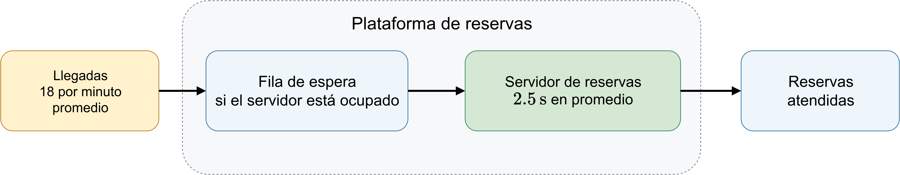
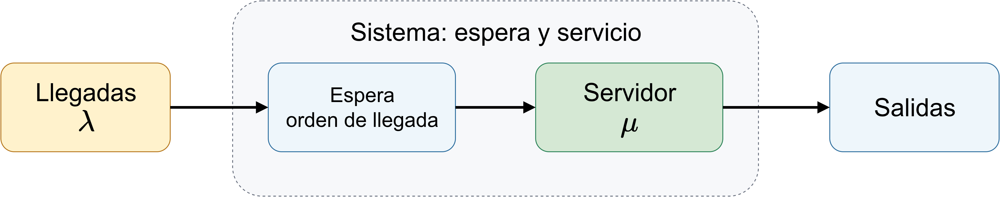
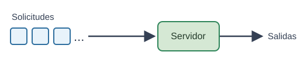
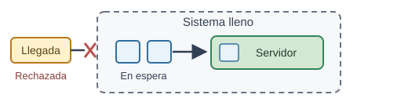
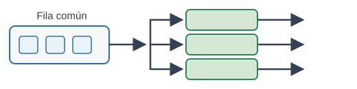
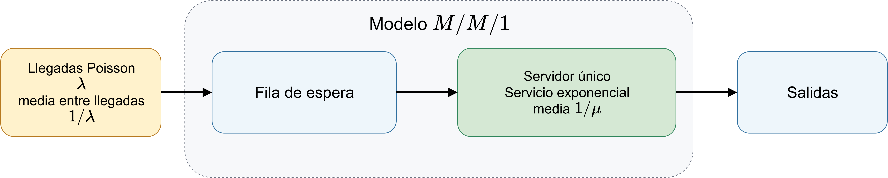
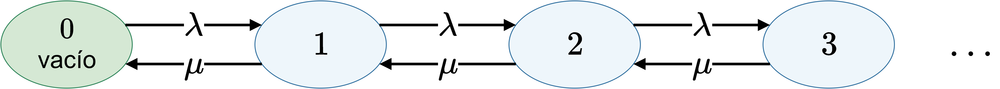

<!-- _class: lead -->

# TEL211
## Disponibilidad y Rendimiento de Sistemas de Tecnologías de Información y Comunicaciones (TIC)
### Teoría de filas: de la carga al tiempo de respuesta

Patricio Olivares R.  
Universidad Técnica Federico Santa María

---

## Un servicio puede estar disponible y responder tarde

En hora punta llegan $18\ \mathrm{solicitudes}\,\mathrm{min}^{-1}$ a una plataforma de reservas. Un servidor tarda, en promedio, $2.5\ \mathrm s$ en atender cada solicitud.

Si el servidor está ocupado, la nueva solicitud espera. El servicio sigue disponible, pero la disponibilidad no indica cuánto demora cada respuesta.

---

## ¿Qué estudia la teoría de filas?

La teoría de filas estudia sistemas donde solicitudes llegan, esperan si los servidores están ocupados, reciben servicio y salen. Si no queda espacio, se rechazan.

Un modelo describe las llegadas, el espacio de espera, la capacidad de servicio y el orden de atención. Así permite estimar tiempos de respuesta, solicitudes acumuladas, utilización y bloqueo.

---

## Qué observaremos bajo carga

| Pregunta | Medida |
|---|---|
| ¿Cuánto tarda una solicitud, en promedio? | $W$ (*waiting*): desde la admisión hasta la salida. $W_q$: solo la espera. |
| ¿Cuántas solicitudes hay, en promedio? | $L$ (*line*): en todo el sistema. $L_q$: solo en espera. |
| ¿Qué fracción del tiempo está ocupado el servidor? | Utilización $\rho$ |
| ¿Qué probabilidad hay de rechazar una llegada? | Bloqueo $P_{\mathrm B}$ y tasa efectiva $\lambda_{\mathrm e}$ |
| ¿Cuántos servidores satisfacen el objetivo? | Capacidad y latencia para un SLA |

---

## Magnitudes y frontera

| Magnitud | Significado | Unidad típica |
|---|---|---|
| $\lambda$ | tasa de llegada ofrecida | $\mathrm{solicitudes}\,\mathrm{s}^{-1}$ |
| $\lambda_{\mathrm e}$ | tasa efectiva admitida | $\mathrm{solicitudes}\,\mathrm{s}^{-1}$ |
| $\mu$ | tasa de servicio por servidor | $\mathrm{solicitudes}\,\mathrm{s}^{-1}$ |
| $L,L_q$ | número medio en sistema y en espera | solicitudes |
| $W,W_q$ | tiempo medio en sistema y en espera | $\mathrm{s}$ |
| $\rho$ | utilización: fracción de capacidad ocupada | adimensional |
| $P_{\mathrm B}$ | probabilidad de bloqueo | adimensional |

Un acuerdo de nivel de servicio (SLA) fija el objetivo de latencia, bloqueo u otra métrica que se debe satisfacer.

---

## Anatomía de una fila

La frontera del sistema incluye a quienes esperan y a quienes están en servicio. Una llegada puede entrar o ser rechazada si no queda espacio.

El tiempo de respuesta va desde la admisión hasta la salida. El tiempo de espera termina cuando comienza el servicio.

---

## Llegadas y servicio en Kendall

$A$ viene de *Arrival* y describe los tiempos entre llegadas. $S$ viene de *Service* y describe los tiempos de servicio. Cada campo puede tomar uno de estos valores:

| Valor | Significado |
|---|---|
| $M$ | *Markovian*. La exponencial no tiene memoria. En $A$ corresponde a llegadas Poisson y en $S$ a servicio exponencial. |
| $D$ | *Deterministic*. El tiempo entre llegadas o el tiempo de servicio es fijo. |
| $G$ | *General*. Se permite otra distribución de probabilidad. |

---

## Servidores, capacidad, población y disciplina

Los campos restantes describen los recursos y las reglas del sistema:

| Campo | Significado |
|---|---|
| $c$ | Número de servidores en paralelo. |
| $K$ | Capacidad máxima dentro del sistema, incluido quien recibe servicio. |
| $N$ | *Number* de fuentes posibles de solicitudes. |
| $D$ | *Discipline*, regla que decide quién sigue. FCFS (*First Come, First Served*) atiende en orden de llegada. |

En los campos $A$ o $S$, $D$ significa *Deterministic*. Como último campo, $D$ significa *Discipline*.

---

## Notación

Los seis campos aparecen en este orden: $A/S/c/K/N/D$. El símbolo $\infty$ indica que la capacidad o la población no tienen límite.

Por ejemplo, $M/M/2/10/\infty/\mathrm{FCFS}$ describe llegadas Poisson, servicio exponencial, dos servidores, capacidad total de diez, población ilimitada y atención en orden de llegada.

Aquí $N(t)$ representa el número de solicitudes dentro del sistema en el instante $t$. En Kendall, $N$ representa la población fuente.

---

## Ejemplos de modelos de Kendall

$M/M/1$ representa llegadas Poisson, servicios exponenciales y un servidor. Si no se especifica, se suponen capacidad y población infinitas.

$M/M/1/K$ limita el número total de solicitudes. Con $K=4$, una recibe servicio y hasta tres esperan.

$M/M/c$ tiene $c$ servidores en paralelo y una fila común. La tasa $\mu$ corresponde a cada servidor.

La abreviatura resume supuestos que deben coincidir con el proceso real.

---

## Modelos de sistemas de atención

Los modelos cambian en número de servidores y límite de solicitudes admitidas.

| Modelo | Esquema | Qué permite estudiar |
|---|---|---|
| $M/M/1$ |  | Un servidor y espera ilimitada. Permite estudiar utilización, número medio y tiempo de respuesta. |
| $M/M/1/K$ |  | $K$ limita el total, incluida la solicitud atendida. Si se llena, rechaza llegadas. Permite estudiar bloqueo y pérdidas. |
| $M/M/c$ |  | Una fila común alimenta $c$ servidores. Si todos están ocupados, hay espera. Permite estudiar el efecto de agregar servidores. |

---

## Proceso Poisson en sistemas de atención

Las solicitudes llegan de forma independiente y a una tasa media constante $\lambda$. Sea $N_A(t)$ el número de llegadas durante un intervalo de duración $t$. Para $k=0,1,2,\ldots$, $k!$ indica el factorial de $k$:

$$
P(N_A(t)=k)=\frac{(\lambda t)^k e^{-\lambda t}}{k!},\qquad k=0,1,2,\ldots
$$

Con $\lambda=6\ \mathrm{solicitudes}\,\mathrm{min}^{-1}$, la probabilidad de recibir exactamente dos solicitudes en un minuto es:

$$
P(N_A(1\ \mathrm{min})=2)=\frac{6^2e^{-6}}{2!}\approx0.0446.
$$

---

## Tiempos entre llegadas en sistemas de atención

Si las llegadas siguen un proceso de Poisson, los tiempos $T$ entre llegadas consecutivas son independientes y exponenciales. Para un umbral temporal $t$, la cola de $T$ y su media $E[T]$ son:

$$
P(T>t)=e^{-\lambda t},\qquad E[T]=\frac{1}{\lambda}.
$$

Con $\lambda=6\ \mathrm{min}^{-1}$, el tiempo medio es $1/6\ \mathrm{min}=10\ \mathrm s$.

La distribución exponencial no tiene memoria. Para una espera previa $s$ y un periodo adicional $t$:

$$
P(T>s+t\mid T>s)=P(T>t).
$$

Haber esperado $s$ sin una llegada no cambia la distribución del tiempo restante.

---

## Poisson y servicio en $M/M/1$

La primera $M$ indica llegadas Poisson, con tiempos entre llegadas exponenciales de media $1/\lambda$. La segunda $M$ indica tiempos de servicio exponenciales de media $1/\mu$. El $1$ representa un servidor. Las llegadas y los tiempos de servicio se suponen independientes.

---

## Ley de Little

Conocemos el número medio de solicitudes presentes y cuántas se completan por segundo. ¿Cuánto permanece cada solicitud?

En régimen estable, la Ley de Little relaciona estas medidas:

$$
L=\lambda_{\mathrm e}W
$$

$L$ cuenta las solicitudes en el sistema. $W$ es su tiempo medio desde la admisión hasta la salida y $\lambda_{\mathrm e}$ la tasa efectiva admitida.

Para esas mismas solicitudes mientras esperan:

$$
L_q=\lambda_{\mathrm e}W_q
$$

$L_q$ cuenta las solicitudes en espera y $W_q$ es su tiempo medio de espera.

No requiere distribuciones exponenciales. Use la misma población y frontera.

---

## ¿De dónde sale la Ley de Little?

Más solicitudes completadas por segundo o más tiempo de permanencia implican más solicitudes presentes. Si se completan $10\ \mathrm{solicitudes}\,\mathrm{s}^{-1}$ y cada una permanece $2\ \mathrm s$, hay $20$ solicitudes en promedio:

$$
(10\ \mathrm{solicitudes}\,\mathrm{s}^{-1})(2\ \mathrm s)=20\ \mathrm{solicitudes}.
$$

El producto de la tasa por el tiempo de permanencia da el número medio de solicitudes presentes.

---

## El área bajo $N(t)$

En cada instante $t$, $N(t)$ cuenta las solicitudes en el sistema. El área $\int_0^T N(t)\,\mathrm{d}t$ suma su tiempo total de permanencia durante una observación de duración $T$.

En una observación larga, el efecto de sus extremos es pequeño. El tiempo acumulado se aproxima a $C(T)W$, donde $C(T)$ es el número de solicitudes completadas. Como $C(T)/T$ se aproxima a $\lambda_{\mathrm e}$:

$$
L=\lim_{T\to\infty}\frac{1}{T}\int_0^T N(t)\,\mathrm{d}t
=\lim_{T\to\infty}\frac{C(T)}{T}W
=\lambda_{\mathrm e}W.
$$

---

## Ejemplo Ley de Little

Una interfaz de programación de aplicaciones (API) completa $120$ solicitudes por segundo y se observan, en promedio, $18$ solicitudes dentro del sistema.

$$
W=\frac{L}{\lambda_{\mathrm e}}
=\frac{18}{120\ \mathrm s^{-1}}
=0.15\ \mathrm s
$$

Si $L_q=12$:

$$
W_q=\frac{12}{120\ \mathrm s^{-1}}
=0.10\ \mathrm s
$$

Por diferencia, el tiempo medio en servicio es $0.05\ \mathrm s$.

---

## Espera y servicio

El tiempo medio de respuesta se descompone en el tiempo medio de espera y el tiempo medio de servicio. Si cada solicitud admitida recibe un servicio que dura, en promedio, $1/\mu$:

$$
W=W_q+\frac{1}{\mu}.
$$

En el ejemplo, $0.15\ \mathrm s=0.10\ \mathrm s+0.05\ \mathrm s$. Esta igualdad descompone el tiempo de respuesta. No es la Ley de Little.

---

## Modelo $M/M/1$

En $M/M/1$, las solicitudes llegan al azar, pueden esperar si el servidor está ocupado y son atendidas por un único servidor.

Las llegadas siguen un proceso de Poisson con tasa $\lambda$. Los tiempos de servicio son exponenciales con tasa $\mu$. El servidor atiende en orden de llegada.

Se suponen capacidad de espera y población fuente ilimitadas. El proceso de llegadas y los tiempos de servicio son independientes.

---

## Utilización y estabilidad

$\lambda$ es el número medio de solicitudes que llegan por unidad de tiempo. $\mu$ es el número que un servidor ocupado puede atender por unidad de tiempo.

La utilización es:

$$
\rho=\frac{\lambda}{\mu}.
$$

En régimen estacionario, $\rho$ es la fracción del tiempo que el servidor está ocupado. Los tres casos son:

| Condición | Comportamiento |
|---|---|
| $\lambda<\mu$ | Estable. Existe régimen estacionario con un número medio finito de solicitudes. |
| $\lambda=\mu$ | Límite de estabilidad. No hay distribución estacionaria. |
| $\lambda>\mu$ | Sobrecarga. La fila crece sin límite a largo plazo. |

---

## Cuando la llegada supera el servicio

Si llegan $12\ \mathrm{solicitudes}\,\mathrm{min}^{-1}$ y el servidor puede atender $10\ \mathrm{solicitudes}\,\mathrm{min}^{-1}$:

$$
\lambda=12,\qquad \mu=10,\qquad \rho=\frac{12}{10}=1.2.
$$

El valor $\rho=1.2$ no significa que el servidor esté ocupado el $120\%$ del tiempo. Fuera del régimen estable, $\rho$ compara la carga ofrecida con la capacidad.

La tasa de llegada supera la capacidad en dos solicitudes por minuto. A largo plazo, la acumulación crece aproximadamente a ese ritmo.

Las fórmulas estacionarias de $M/M/1$ solo se aplican bajo esta condición:

$$
\boxed{\lambda<\mu\quad\Longleftrightarrow\quad\rho<1}.
$$

Incluso en este régimen, la variabilidad puede formar filas.

---

## ¿Por qué se forma una fila si $\lambda<\mu$?

Aunque la llegada media sea menor que la capacidad, algunas solicitudes pueden coincidir mientras el servidor está ocupado. Para seguir la acumulación usamos el estado

$$
N(t)=\text{número de solicitudes dentro del sistema}.
$$

Con servicio exponencial, basta conocer cuántas solicitudes hay. Otras distribuciones pueden exigir más información sobre el servicio en curso.

---

## $M/M/1$ como proceso de nacimiento y muerte

El estado $n$ cuenta las solicitudes en el sistema. El proceso cambia el estado de uno en uno. Cada llegada es un nacimiento y cada servicio completado es una muerte.

$$
n\to n+1\text{ a tasa }\lambda
$$

$$
n\to n-1\text{ a tasa }\mu,\qquad n\ge1
$$

---

## Distribución estacionaria de $M/M/1$

Sea $\pi_n$ la probabilidad estacionaria de tener $n$ solicitudes. $\pi_0$ corresponde al sistema vacío.

En equilibrio se igualan los flujos vecinos. Cada flujo es la probabilidad del estado de origen por su tasa de transición:

$$
\pi_n\lambda=\pi_{n+1}\mu
\quad\Longrightarrow\quad
\pi_n=\rho^n\pi_0.
$$

Al normalizar, la serie geométrica converge si $\rho<1$:

$$
1=\sum_{n=0}^{\infty}\pi_n
=\pi_0\sum_{n=0}^{\infty}\rho^n
=\frac{\pi_0}{1-\rho}
\quad\Longrightarrow\quad
\pi_0=1-\rho,
\qquad
\pi_n=(1-\rho)\rho^n.
$$

La suma es una serie geométrica infinita: $\sum_{n=0}^{\infty}\rho^n=\frac{1}{1-\rho}$, válida para $0\leq\rho<1$. Ver [serie geométrica](https://es.wikipedia.org/wiki/Serie_geom%C3%A9trica).

---

## Interpretar la estabilidad

La serie geométrica converge solo si $\rho<1$. En $M/M/1$, esta condición permite normalizar la distribución estacionaria.

Si $\lambda=\mu$, no hay régimen estacionario con promedios finitos. Si $\lambda>\mu$, la carga supera la capacidad.

En ambos casos fallan las fórmulas estacionarias de $M/M/1$. Se puede reducir llegadas, aumentar el servicio o agregar servidores. Limitar la capacidad evita una fila infinita, pero causa pérdidas.

---

## Obtener el número medio en el sistema

Con $\pi_n=(1-\rho)\rho^n$:

$$
L=\sum_{n=0}^{\infty}n\pi_n=(1-\rho)\sum_{n=0}^{\infty}n\rho^n.
$$

Esta suma es un caso de una [serie aritmético-geométrica](https://es.wikipedia.org/wiki/Secuencia_aritm%C3%A9tico-geom%C3%A9trica):

$$
\sum_{n=0}^{\infty}n\rho^n=\frac{\rho}{(1-\rho)^2}.
$$

Por tanto:

$$
L=\frac{\rho}{1-\rho}.
$$

---

## Número medio en espera

Sea $N$ el número de solicitudes en el sistema y $Q$ el número esperando. Como hay un solo servidor:

$$
Q=N-\mathbf{1}_{\{N\geq1\}},
$$

con el indicador igual a uno si el servidor está ocupado y cero si está libre. En régimen estacionario:

$$
L_q=\mathbb{E}[Q]=\mathbb{E}[N]-\mathbb{P}(N\geq1)=L-\mathbb{P}(\text{servidor ocupado}).
$$

En $M/M/1$, $\pi_0=1-\rho$, por lo que:

$$
\mathbb{P}(N\geq1)=1-\pi_0=\rho,
$$

Por tanto, el número medio total se descompone en solicitudes en espera y en servicio. Como hay un solo servidor, el número medio en servicio es $\rho$:

$$
L=L_q+\rho
\quad\Longrightarrow\quad
L_q=L-\rho.
$$

---

## Métricas de $M/M/1$

> Estas fórmulas describen promedios estacionarios y se aplican cuando $\rho<1$.

**Número medio de solicitudes**

$L$ cuenta las solicitudes en espera y en servicio. $L_q$ cuenta solo las que esperan. Como se explicó antes, $L_q=L-\rho$.

$$
\begin{aligned}
L &=\frac{\rho}{1-\rho}=\frac{\lambda}{\mu-\lambda},\\
L_q &=\frac{\rho^2}{1-\rho}=\frac{\lambda^2}{\mu(\mu-\lambda)}.
\end{aligned}
$$

**Tiempo medio de permanencia**

$W$ mide el tiempo desde que una solicitud llega hasta que sale. $W_q$ mide solo el tiempo que espera en la fila. Como la cola es ilimitada, todas las llegadas entran al sistema y la tasa efectiva es $\lambda$. Por la ley de Little, $L=\lambda W$ y $L_q=\lambda W_q$.

$$
\begin{aligned}
W &=\frac{L}{\lambda}=\frac{1}{\mu-\lambda},\\
W_q &=\frac{L_q}{\lambda}=\frac{\lambda}{\mu(\mu-\lambda)}=\frac{\rho}{\mu-\lambda}.
\end{aligned}
$$

---

## Por qué la latencia crece tan rápido

$$
W=\frac{1}{\mu(1-\rho)}
$$

El tiempo medio de servicio es $1/\mu$. La siguiente tabla expresa el tiempo total de permanencia $W$ como múltiplo de ese tiempo $\frac{W}{1/\mu}=\frac{1}{1-\rho}.$

<table style="margin: 0 auto; text-align: center;">
<thead>
<tr><th>ρ</th><th>W/(1/μ)</th></tr>
</thead>
<tbody>
<tr><td>0.50</td><td>2 veces</td></tr>
<tr><td>0.80</td><td>5 veces</td></tr>
<tr><td>0.90</td><td>10 veces</td></tr>
<tr><td>0.95</td><td>20 veces</td></tr>
</tbody>
</table>

---

## Por qué la latencia crece tan rápido

Por ejemplo, con $\rho=0.95$, el tiempo medio total es $20$ veces el tiempo de servicio. De ese total, $19$ veces corresponden a la espera en la fila, pues $W_q=W-1/\mu$. El servicio no se vuelve más lento. El aumento se debe a la espera.

El modelo es estable cuando $\rho<1$. Al acercarse $\rho$ a $1$, el factor $1/(1-\rho)$ crece rápidamente y queda menos margen para variaciones en la carga.

---

## Ejemplo $M/M/1$: puerta de enlace

Considere una puerta de enlace que recibe solicitudes y las envía a un único servidor. 

Modele las llegadas como un proceso de Poisson y los tiempos de servicio como exponenciales e independientes. Suponga que $\lambda=125\ \mathrm{solicitudes/s}$ y que el tiempo medio de servicio es $1/\mu=2\ \mathrm{ms}$.

### Preguntas

1. Calcule la tasa media de servicio $\mu$ y la utilización $\rho$. Determine si el sistema es estable.
2. Calcule el tiempo medio de permanencia $W$ y el tiempo medio de espera $W_q$.
3. Calcule el número medio de solicitudes en el sistema $L$ y en la fila $L_q$. Interprete los resultados.

---

## Ejemplo $M/M/1$: respuestas

**Tasa media de servicio**

$$
\mu=\frac{1}{\mathbb{E}[S]}=\frac{1}{2\ \mathrm{ms}}=500\ \mathrm{solicitudes/s}.
$$

**Utilización y estabilidad**

$$
\rho=\frac{\lambda}{\mu}=\frac{125}{500}=0.25<1.
$$

El sistema es estable porque $\rho<1$.

---

## Ejemplo $M/M/1$: respuestas de tiempo

$W$ mide el tiempo desde la llegada hasta la salida. $W_q$ mide solo la espera en la fila.

**Permanencia media en el sistema**

$$
W=\frac{1}{\mu-\lambda}=\frac{1}{500-125}\ \mathrm{s}=2.667\ \mathrm{ms}.
$$

**Espera media en la fila**

$$
W_q=\frac{\lambda}{\mu(\mu-\lambda)}=\frac{125}{500(500-125)}\ \mathrm{s}=0.667\ \mathrm{ms}.
$$

---

## Ejemplo $M/M/1$: respuestas de cantidad

Por la ley de Little, $L=\lambda W$ y $L_q=\lambda W_q$:

$$
\begin{aligned}
L &=\lambda W=(125\ \mathrm{solicitudes/s})(0.002667\ \mathrm{s})=0.333\ \mathrm{solicitudes},\\
L_q &=\lambda W_q=(125\ \mathrm{solicitudes/s})(0.000667\ \mathrm{s})=0.083\ \mathrm{solicitudes}.
\end{aligned}
$$

En promedio, cada solicitud permanece $2.667\ \mathrm{ms}$ en el sistema, incluidos $0.667\ \mathrm{ms}$ de espera y $2\ \mathrm{ms}$ de servicio. $L$ y $L_q$ son promedios temporales, por eso pueden ser menores que una solicitud.

---

## Capacidad finita: $M/M/1/K$

$K$ es el número máximo de solicitudes **en el sistema**, incluyendo quien está en servicio.

Los estados son $0,1,\ldots,K$. En estado $K$, una nueva solicitud es rechazada y no cambia el estado. En el estado $0$, el sistema está vacío y el servidor ocioso. No hay una solicitud en servicio que pueda salir.

El balance entre vecinos sigue dando $\pi_n=\pi_0\rho^n$, pero ahora la normalización tiene solo $K+1$ términos. Aquí $\rho=\lambda/\mu$ compara la carga de solicitudes con la capacidad.

Incluso con $\rho\geq1$ **existe una distribución estacionaria** en esta cadena finita. Eso no garantiza una pérdida aceptable.

---

## Capacidad finita: normalización

**Balance.** Igualando los flujos entre $n$ y $n+1$: $\pi_n\lambda=\pi_{n+1}\mu$. Como $\lambda/\mu=\rho$, se obtiene $\pi_n=\rho^n\pi_0$.

**Normalización.** Las probabilidades suman uno:

$$
1=\pi_0\sum_{n=0}^{K}\rho^n
$$

Por tanto, para todo $\rho$:

$$
\pi_n=\frac{\rho^n}{\sum_{k=0}^{K}\rho^k}
$$

La distribución está truncada por la capacidad: los clientes que no entran no aparecen en estos estados.

---

## Capacidad finita: suma geométrica

Sea $S=\sum_{n=0}^{K}\rho^n$. Restamos $\rho S$, es decir, la misma suma multiplicada por $\rho$:

$$
\begin{aligned}
S&=1+\rho+\cdots+\rho^K,\\
\rho S&=\rho+\cdots+\rho^K+\rho^{K+1}.
\end{aligned}
$$

Los términos $\rho,\ldots,\rho^K$ aparecen en ambas sumas y se cancelan:

$$
S-\rho S=1-\rho^{K+1}
$$

Si $\rho\neq1$, despejamos $S=\dfrac{1-\rho^{K+1}}{1-\rho}$.

---

## Capacidad finita: distribución

Como $\pi_n=\rho^n/S$, para $\rho\neq1$:

$$
\pi_n=\frac{(1-\rho)\rho^n}{1-\rho^{K+1}}
$$

Si $\rho=1$, cada término de $S$ vale $1$, luego $S=K+1$ y $\pi_n=\dfrac{1}{K+1}$.

La suma es finita, así que no se exige $\rho<1$. En $M/M/1$, en cambio, la serie infinita solo converge si $\rho<1$.

Si $\rho<1$ y $K\to\infty$, entonces $\rho^{K+1}\to0$ y $\pi_n\to(1-\rho)\rho^n$, la distribución estacionaria de $M/M/1$.

---

## Sobrecarga: $\rho\geq1$ en $M/M/1$ y en $M/M/1/K$

En $M/M/1$, la distribución estacionaria existe solo si $\rho<1$.

| Con $\rho\geq1$ | $M/M/1$ | $M/M/1/K$ |
|---|---|---|
| Distribución estacionaria | No existe | Existe |
| Tamaño de la fila | Crece sin límite | Nunca supera $K$ |
| Llegadas con sistema lleno | Esperan | Se rechazan |

Con capacidad finita, una llegada que encuentra el sistema lleno se rechaza y se produce **bloqueo**. Así, la tasa de solicitudes que llegan, $\lambda$, no coincide con la tasa que realmente entra al sistema, $\lambda_{\mathrm e}$.

---

## Bloqueo y tasa efectiva

El bloqueo $P_{\mathrm B}$ es la probabilidad de que el sistema esté a capacidad completa:

$$
P_{\mathrm B}=\pi_K
$$

Las llegadas de Poisson ven el sistema como en un instante cualquiera (*Poisson Arrivals See Time Averages*, PASTA). Por eso, $P_{\mathrm B}$ también es la fracción de llegadas rechazadas, y $1-P_{\mathrm B}$ es la fracción que entra al sistema. Como las llegadas ofrecidas ocurren a tasa $\lambda$, la tasa admitida es:

$$
\lambda_{\mathrm e}=\lambda(1-P_{\mathrm B})
$$

Las llegadas admitidas excluyen los rechazos y no forman necesariamente un proceso de Poisson.

---

## Ejemplo: bloqueo con $\rho\geq1$

Con $\rho=1.2$ y $K=3$, la probabilidad de bloqueo es $P_{\mathrm B}=\pi_3$:

$$
P_{\mathrm B}=\pi_3=\frac{\rho^3}{1+\rho+\rho^2+\rho^3}=\frac{1.728}{5.368}\approx0.322
$$

Con $\lambda=12$ y $\mu=10$ solicitudes/min, la tasa admitida es:

$$
\lambda_{\mathrm e}=\lambda(1-P_{\mathrm B})\approx8.14\ \text{solicitudes/min}
$$

Aunque $\lambda>\mu$, la tasa admitida es menor que $\mu$. La diferencia $\lambda-\lambda_{\mathrm e}$ corresponde a las solicitudes rechazadas.

Que las medidas sean finitas no implica una pérdida aceptable. Esa valoración depende del SLA.

---

## Tasa admitida y ocupación

En equilibrio, el número de solicitudes en el sistema no crece de forma sostenida, así que lo que entra debe salir. Entran las solicitudes admitidas, a tasa $\lambda_{\mathrm e}$. Salen a tasa $\mu$ cuando el servidor está ocupado, lo que ocurre con probabilidad $1-\pi_0$. Por tanto:

$$
\lambda_{\mathrm e}=\mu(1-\pi_0).
$$

La ocupación real es $1-\pi_0=\lambda_{\mathrm e}/\mu$. No es necesariamente igual a la carga ofrecida $\lambda/\mu$.

---

## Medidas de los clientes admitidos

Para $\lambda_{\mathrm e}>0$, las medidas de los clientes admitidos son:

$$
L=\sum_{n=0}^{K}n\pi_n,\qquad L_q=L-(1-\pi_0).
$$

- $L$ promedia $n$ usando $\pi_n$ como pesos: son las solicitudes medias en el sistema.
- Con el servidor ocupado hay una solicitud en servicio, y eso ocurre con probabilidad $1-\pi_0$. Por eso $L_q$ resta ese valor a $L$.

$$
W=\frac{L}{\lambda_{\mathrm e}},\qquad W_q=\frac{L_q}{\lambda_{\mathrm e}}=W-\frac{1}{\mu}.
$$

- Se aplica la ley de Little a las solicitudes admitidas, que entran a tasa $\lambda_{\mathrm e}$.
- El servicio medio es $1/\mu$. Se descuenta de $W$ para obtener $W_q$.

---

## Ejemplo bloqueo $M/M/1/K$

En una fila $M/M/1/K$, considere $\lambda=8\ \mathrm{s}^{-1}$, $\mu=10\ \mathrm{s}^{-1}$ y $K=3$.

**Carga $\rho$.** Con $\rho=\lambda/\mu$:

$$
\rho=\frac{8}{10}=0.8
$$

**Bloqueo $P_{\mathrm B}$.** Con $P_{\mathrm B}=\pi_K=\dfrac{(1-\rho)\rho^K}{1-\rho^{K+1}}$:

$$
P_{\mathrm B}=\frac{(0.2)(0.8)^3}{1-(0.8)^4}\approx0.173442
$$

---

## Ejemplo bloqueo $M/M/1/K$: tasa admitida

Con $\lambda=8\ \mathrm{s}^{-1}$ y $P_{\mathrm B}\approx0.173442$:

**Tasa admitida $\lambda_{\mathrm e}$.** Con $\lambda_{\mathrm e}=\lambda(1-P_{\mathrm B})$:

$$
\lambda_{\mathrm e}=8(1-0.173442)\approx6.6125\ \mathrm{s}^{-1}
$$

Usar $\lambda$ en lugar de $\lambda_{\mathrm e}$ incluye solicitudes rechazadas y subestima el tiempo $W=L/\lambda_{\mathrm e}$ de los clientes admitidos.

---

## Ejemplo bloqueo $M/M/1/K$: distribución

Con $\rho=0.8$ y $K=3$:

**Probabilidades $\pi_n$.** Con $\pi_n=\dfrac{(1-\rho)\rho^n}{1-\rho^{K+1}}$:

$$
\pi_n=\frac{(0.2)(0.8)^n}{0.5904}
$$

Así, $\pi_0\approx0.338753$, $\pi_1\approx0.271003$, $\pi_2\approx0.216802$ y $\pi_3\approx0.173442$.

**Número medio en el sistema $L$.** Con $L=\sum_{n=0}^{K}n\pi_n$:

$$
L=0.271003+2(0.216802)+3(0.173442)\approx1.224932
$$

---

## Ejemplo bloqueo $M/M/1/K$: tiempos

**Tiempo en el sistema $W$.** Con $W=L/\lambda_{\mathrm e}$, por la ley de Little aplicada a los clientes admitidos:

$$
W=\frac{1.224932}{6.6125}\approx0.185246\ \mathrm{s}
$$

**Tiempo de espera $W_q$.** Con $W_q=W-1/\mu$:

$$
W_q=0.185246-0.1\approx0.085246\ \mathrm{s}
$$

El tiempo $W$ corresponde a clientes admitidos. El bloqueo se informa aparte, porque las solicitudes rechazadas no reciben servicio.

---

## Ejemplo $M/M/1/K$: espacio de espera

Una puerta de enlace recibe paquetes con tasa $\lambda=125$ paquetes/s, y su tiempo de servicio medio es $2$ ms. Se modela como $M/M/1/K$, donde $K$ incluye el paquete en servicio y $B=K-1$ es el número de puestos de espera. Se pide:

1. Calcule $\mu$ y $\rho$.
2. Calcule $P_{\mathrm B}$ para $K=9$, $K=10$ y $K=14$.
3. Determine el menor $K$ con $P_{\mathrm B}\leq10^{-6}$ (un paquete perdido por millón) y el número de puestos de espera correspondiente.

---

## Ejemplo $M/M/1/K$: tasa y carga

**Tasa de servicio $\mu$.** Con $\mu=1/\mathbb{E}[S]$:

$$
\mu=\frac{1}{2\ \mathrm{ms}}=500\ \text{paquetes/s}
$$

**Carga $\rho$.** Con $\rho=\lambda/\mu$:

$$
\rho=\frac{125}{500}=0.25
$$

Como $\rho<1$, la carga ofrecida es menor que la capacidad. Aun así, una capacidad finita produce pérdidas.

---

## Ejemplo $M/M/1/K$: bloqueo

Con $\rho=0.25$, la probabilidad de bloqueo es $P_{\mathrm B}=\pi_K$:

$$
P_{\mathrm B}=\pi_K=\frac{(1-\rho)\rho^K}{1-\rho^{K+1}}=\frac{0.75\,(0.25)^K}{1-(0.25)^{K+1}}
$$

Con $B=K-1$ puestos de espera, para cada capacidad:

$$
\begin{aligned}
K=9\ (B=8):&\quad P_{\mathrm B}=\frac{0.75(0.25)^9}{1-(0.25)^{10}}\approx2.861\times10^{-6},\\
K=10\ (B=9):&\quad P_{\mathrm B}=\frac{0.75(0.25)^{10}}{1-(0.25)^{11}}\approx7.153\times10^{-7},\\
K=14\ (B=13):&\quad P_{\mathrm B}=\frac{0.75(0.25)^{14}}{1-(0.25)^{15}}\approx2.794\times10^{-9}.
\end{aligned}
$$

---

## Ejemplo $M/M/1/K$: capacidad

Para $K=9$, $P_{\mathrm B}\approx2.861\times10^{-6}>10^{-6}$. Para $K=10$, $P_{\mathrm B}\approx7.153\times10^{-7}\leq10^{-6}$.

**Capacidad $K$.** Se elige el menor $K$ con $P_{\mathrm B}=\pi_K\leq10^{-6}$:

$$
K=10
$$

**Puestos de espera $B$.** Con $B=K-1$, porque el paquete en servicio ocupa un lugar:

$$
B=10-1=9
$$
